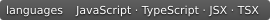

[English](README.md) | [中文](README.zh.md)

<div align="center">

<p align="center"> </p>

# Hello React

<p align="center">
  
  
  
  
</p>

游戏开发者的 React 开发笔记 · [在线阅读](https://cuihairu.github.io/hello-react/) · [技术索引](https://cuihairu.github.io/hello-react/knowledge)

</div>

---

个人学习笔记、心得与开发经验分享，来自游戏开发者视角，涉及 TypeScript、架构、Hooks、构建工具、源码与生态。

## 本地开发

```bash
npm install         # 安装依赖
npm run docs:dev    # 本地开发
npm run docs:build  # 构建到 docs/.vitepress/dist，检查源级死链
npm run docs:preview # 本地预览构建产物
npm run audit:links # 扫描构建产物中的死链与失效锚点
```

死链检查分两层：VitePress 构建时对源级死链直接报错，`audit:links` 扫描构建产物中指向被排除文件或失效锚点的链接（CI 每次构建后执行）。

## 目录结构

```
hello-react/
├── docs/                     # VitePress 内容与站点配置（主编辑源）
│   ├── .vitepress/sidebar.json # 站点侧栏权威源
│   ├── api/ architecture/ basics/ build-tools/ ecosystem/
│   ├── future/ projects/ source-code/ typescript-react/
│   ├── public/ review/        # 静态资源与审计报告
│   ├── index.md              # 首页
│   ├── knowledge.md / timeline.md / glossary.md
│   └── SUMMARY.md            # mdBook 遗留说明，不是导航副本
├── src/                      # mdBook 遗留源文件，非站点编辑源
├── scripts/audit-links.mjs   # 构建产物站内链接审计
├── package.json              # 依赖与脚本
└── README.md / README.zh.md  # 项目说明（中英文）
```

VitePress 从 `docs/` 构建；新增或修改站点内容请编辑 `docs/`。`src/` 与 `book.toml` 为遗留 mdBook 文件，保留原状。站点侧栏只维护在 `docs/.vitepress/sidebar.json`；`docs/SUMMARY.md` 仅说明这一规则。`docs/` 下现有 156 个可构建 Markdown 页面，另有被排除的 `SUMMARY.md`。

## 迁移说明

本站由 mdBook 迁移至 VitePress。内容按主题目录存放，侧栏用于浏览；这里是个人开发笔记与经验记录，内容按主题浏览。

## 许可协议

本作品采用 [Creative Commons Attribution 4.0 International (CC BY 4.0)](https://creativecommons.org/licenses/by/4.0/) 许可协议发布。
